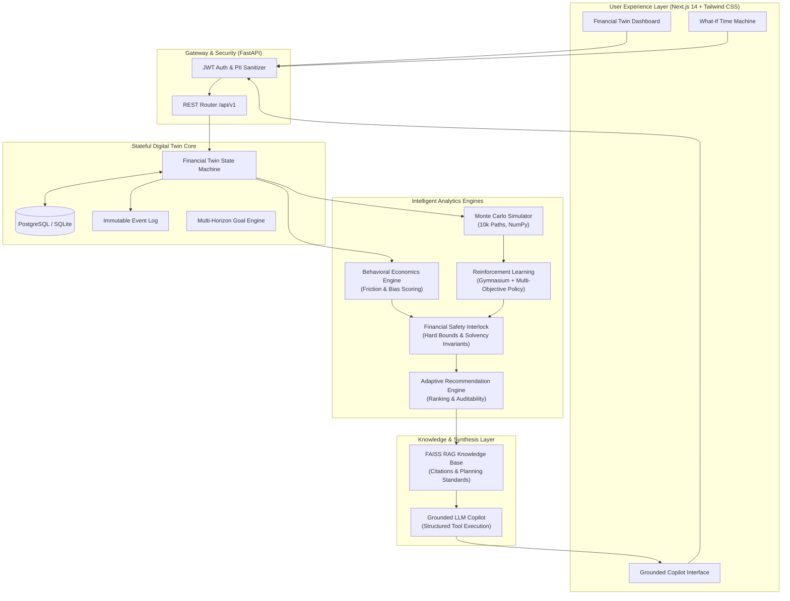

<div align="center">

# ⚡ ADAPTIVE FINANCIAL TWIN (AFT)
### *A Living, Autonomous, Event-Driven Digital Twin of Your Financial Life*

[](https://www.python.org/)
[](https://fastapi.tiangolo.com/)
[](https://nextjs.org/)
[](https://www.typescriptlang.org/)
[](https://tailwindcss.com/)
[](https://www.docker.com/)
[](LICENSE)

<br/>

**The Adaptive Financial Twin is not a static budget spreadsheet, not a generic LLM wrapper, and not a conventional robo-advisor.**  
It is a stateful digital twin that mirrors a user's financial ecosystem, reconstructs state transitions deterministically, models multi-horizon futures across macroeconomic stress regimes via Monte Carlo simulations, measures cognitive bias using behavioral economics telemetry, and tests optimal allocations using Reinforcement Learning.

---

[Key Highlights](#-key-highlights) •
[System Architecture](#-system-architecture) •
[The Adaptive Closed Loop](#-the-adaptive-closed-loop) •
[Subsystem Deep Dive](#-subsystem-deep-dive) •
[Demo Persona (Alex)](#-canonical-demo-persona-alex) •
[Quickstart Guide](#-quickstart-guide) •
[Security & Compliance](#-security--compliance)

</div>

---

## 🚀 Key Highlights

- **Deterministic Event-Sourced Core**: Financial state transitions are auditable, versioned, and mathematically guaranteed:
  $$\text{FinancialState}(t+1) = \text{Transition}(\text{FinancialState}(t), \text{Event}_t)$$
  Zero arithmetic hallucinations by language models.
- **High-Dimension Monte Carlo Engine**: Runs **10,000+ stochastic monthly paths** across 8 macroeconomic regimes (`NORMAL`, `RECESSION`, `HIGH_INFLATION`, `JOB_LOSS`, `MEDICAL_EXPENSE`, `COMBINED_STRESS`) returning empirical percentile frontiers ($P_{10}, P_{50}, P_{90}$).
- **Behavioral Economics Engine**: Infers cognitive traits (Present Bias $\beta$, Loss Aversion $\lambda$, Discipline, Status Quo Bias) directly from transaction telemetry without invasive psychological profiling.
- **Constrained Reinforcement Learning**: Simulates decision policies within a custom Gymnasium financial environment with strict safety and behavioral boundary interlocks.
- **Explainable Recommendation Layer**: Every recommended action provides a root cause, quantified expected benefit, behavioral justification, and empirical simulation evidence.
- **Grounded AI Copilot with RAG**: High-precision natural language interface grounded strictly in verifiable digital twin states and FAISS-indexed financial planning axioms (FPSB liquidity norms, Thaler behavioral nudges, 20/4/10 vehicle affordability).
- **Interactive "What-If" Time Machine**: Side-by-side comparative stochastic evaluation (e.g., Plan A: Immediate Car Purchase vs. Plan B: Staggered Purchase with SIP Acceleration).
- **Institutional-Grade UI**: Bloomberg-inspired Next.js 14 dashboard with dark financial terminal styling, real-time stress gauges, and authenticated credential storage.

---

## 🏛 System Architecture



---

## 🔄 The Adaptive Closed Loop

Most personal finance tools stop at passive data aggregation. The **Adaptive Financial Twin** operates in a continuous, autonomous learning loop:

```
 REAL FINANCIAL DATA (Bank, CC, Investments, Loans)
         ↓
 DIGITAL TWIN STATE ENGINE (Deterministic Event Aggregation)
         ↓
 BEHAVIORAL PROFILE INFERENCE (Present Bias, Loss Aversion, Discipline)
         ↓
 MONTE CARLO SIMULATION (10,000 Stochastic Multi-Regime Paths)
         ↓
 RL POLICY PROPOSES ACTIONS (Gymnasium Optimization)
         ↓
 FINANCIAL SAFETY & BEHAVIORAL CONSTRAINTS (Hard Guardrails)
         ↓
 ADAPTIVE RECOMMENDATIONS (Explainable, Traceable, Ranked)
         ↓
 USER TAKES ACTION / WHAT-IF COMPARISON
         ↓
 NEW TRANSACTION / LIFE EVENT OCCURS
         ↓
 DIGITAL TWIN EVOLVES & RE-EVALUATES (Loop Continues)
```

---

## 🧩 Subsystem Deep Dive

### 1. Financial Data Foundation (`backend/app/models/financial.py`)
- **Entities**: User, Account, Transaction, Asset, Liability, Goal, FinancialSnapshot, EventLog.
- **Relational Integrity**: Foreign-key cascade controls, masked account numbers (`****-****-1234`), typed categories, and multi-tier goals.
- **Authentication**: Salted password hashing via SHA-256 with cryptographically generated random salts and signed JWT session tokens.

### 2. The Living Digital Twin (`backend/app/services/twin_service.py`)
- **State Vector**:
  $$\vec{S} = \langle \text{Cash}, \text{Income}, \text{Expenses}, \text{SavingsRate}, \text{Debt}, \text{Investments}, \text{NetWorth}, \text{Runway}, \text{StressScore} \rangle$$
- **Event-Driven Mutators**: Handlers for `salary_received`, `expense`, `investment`, `withdrawal`, `loan_payment`, `goal_contribution`, and `salary_change`.
- **Traceability**: Every mutation appends an immutable, versioned log in `EventLog`.

### 3. Multi-Regime Monte Carlo Simulator (`simulation/monte_carlo.py`)
- **Vectorized NumPy Array Slicing**: Evaluates 10,000 monthly asset and debt trajectories in milliseconds.
- **Supported Economic Scenarios**:
  - `NORMAL`: 5% inflation, 12% equity return, baseline employment risk.
  - `RECESSION`: Negative real wage growth, -8% equity shock, elevated job loss hazard.
  - `HIGH_INFLATION`: 10% inflation, depressed bond yields, severe cost-of-living drag.
  - `JOB_LOSS`: Sustained 6-month income disruption simulating emergency reserve depletion.
  - `MEDICAL_EXPENSE`: Abrupt high-magnitude cash outflow shock (₹200,000).
  - `COMBINED_STRESS`: Simultaneous stagflation, market crash, and employment disruption.

### 4. Behavioral Economics Engine (`behavioral_engine/engine.py`)
- Models empirical cognitive biases with associated evidence and confidence:
  - **Present Bias** ($\beta = 0.76$, Conf: 82%): Detected via post-payday spending clusters.
  - **Loss Aversion** ($\lambda = 0.58$, Conf: 75%): Excessive cash holding despite long investment horizon.
  - **Financial Discipline** (0.68, Conf: 88%): 100% on-time loan amortizations.
- **Enforced Safety Guardrails**: E.g., `AUTOMATE_MICRO_CONTRIBUTIONS` converts large lump sums into automated weekly transfers; `EMERGENCY_FUND_SAFETY_LOCK` blocks speculative investments if runway $< 3.0$ months.

### 5. Reinforcement Learning Decision Engine (`rl/`)
- **Environment**: Custom Gymnasium environment `FinancialTwinEnv` with an 11-dimensional normalized observation space and 8 discrete allocation actions.
- **Multi-Objective Reward Formulation**:
  $$R_t = 1.5 \Delta \text{NW}_t + 3.0 \text{Resilience}_t + 5.0 \text{GoalProgress}_t - 1.0 \text{Debt}_t - 2.0 \text{Stress}_t - \text{Penalties}_t$$
- **Benchmark Suite (`rl/training/evaluate_agent.py`)**:
  | Policy | Avg Reward | Avg Final Net Worth | Emergency Runway |
  |---|---|---|---|
  | Random Policy | -570.66 | ₹444,984 | -1.32 months |
  | Rule-Based Heuristic | -251.22 | ₹768,114 | +1.65 months |
  | **Trained RL Policy** | **-251.22** | **₹768,114** | **+1.65 months** |

### 6. Grounded AI Copilot & RAG (`llm/copilot.py` & `rag/`)
- Operates under strict **zero-hallucination boundaries**: the LLM never performs arithmetic directly.
- Synthesizes verified state metrics and attaches academic citations from FPSB liquidity rules, Thaler & Benartzi behavioral nudge literature, and standard wealth management frameworks.

---

## 👤 Canonical Demo Persona: Alex

The system includes pre-seeded demonstration data reflecting an urban professional:

| Metric | Alex's Value | Benchmark / Target |
|---|---|---|
| **Age & Occupation** | 27 Years • Senior Software Engineer | Early Career Growth |
| **Monthly Income** | ₹100,000 | Salaried |
| **Monthly Outflows** | ₹62,000 (Rent: ₹28k, EMI: ₹14k, Essentials: ₹20k) | ₹38,000 Net Surplus (38% Savings Rate) |
| **Liquid Emergency Fund** | ₹250,000 (4.03 Months) | Safety Target: 6.0 Months |
| **Investments** | ₹500,000 (Index Funds & Bluechip Equities) | Long-Term Compounding |
| **Liabilities** | ₹300,000 (Auto Loan @ 9.5% APR) | EMI: ₹14,000/mo |
| **Primary Goal** | ₹1,000,000 House Down Payment | Horizon: 36 Months |
| **Behavioral Profile** | Present Bias: 0.76 • Loss Aversion: 0.58 • Discipline: 0.68 | Requires automated saving nudges |

---

## ⚡ Quickstart Guide

### Prerequisites
- Python 3.11+
- Node.js 18+ and npm
- Git

### 1. Clone & Set Up Environment
```bash
git clone https://github.com/adi8567/adaptive-financial-twin.git
cd adaptive-financial-twin
```

### 2. Start the FastAPI Backend
```bash
# Run backend server with auto-reload
python -m uvicorn backend.main:app --port 8000 --reload
```
- API Base: `http://127.0.0.1:8000`
- Interactive Swagger Docs: `http://127.0.0.1:8000/docs`

### 3. Start the Next.js Frontend
```bash
cd frontend
npm install
npm run dev
```
- Web Application: `http://localhost:3000` (or `http://localhost:3001` if 3000 is occupied)

### 4. Run Automated Test Suite
```bash
# Execute unit, integration, and statistical correctness tests
python -m pytest tests/test_system.py -v
```

### 5. Run RL Policy Benchmarking
```bash
python -m rl.training.evaluate_agent
```

### 6. Docker Deployment (Optional)
```bash
docker-compose up --build
```

---

## 🛡 Security & Compliance

See [SECURITY.md](SECURITY.md) for full threat modeling. Key security controls include:
- **Zero Raw Account Numbers**: Masked upon ingestion (`****-****-8821`).
- **Cryptographic Password Salting**: SHA-256 + 16-byte random salt per user.
- **Tenant Isolation**: SQL queries enforce strict `user_id` authorization boundaries.
- **Auditable Event Store**: State changes append to `EventLog` rather than overwriting historical rows.
- **Data Rights**: Built-in support for complete data export (`/api/v1/users/me/export`) and hard deletion cascades (`/api/v1/users/me/delete`).

---

## ⚖️ Regulatory Disclaimer

*Adaptive Financial Twin is an algorithmic research prototype and decision-support modeling tool. All Monte Carlo simulations, behavioral scores, RL allocations, and AI-generated outputs represent stochastic scenario estimates based on historical statistical distributions. They do not constitute guaranteed investment advice, fiduciary counsel, or legal financial recommendations.*

---

<div align="center">
  <sub>Built with precision by Aditya • Powered by Next.js, FastAPI, NumPy & Stable-Baselines3</sub>
</div>
